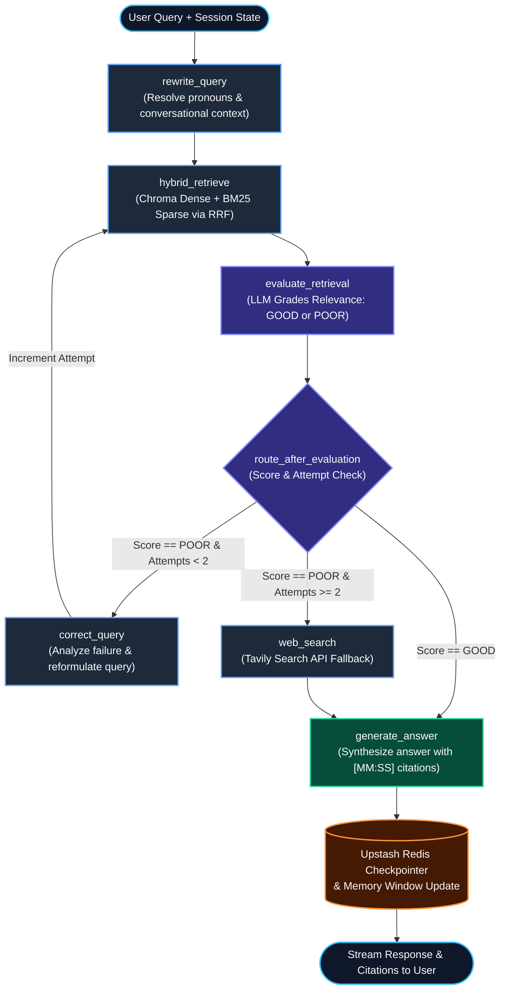

# YouTube RAG Intelligence

An enterprise-grade video intelligence platform that transforms any YouTube video into an interactive, grounded knowledge base. Built with **LangGraph (Corrective RAG - CRAG)**, **LangChain**, **Ollama (`gemma4:31b-cloud`)**, **Google Gemini embeddings**, **hybrid retrieval (in-memory ChromaDB + BM25 with Reciprocal Rank Fusion)**, and **Upstash Redis serverless checkpointing memory**.

Chat with YouTube videos in natural language, generate structured multi-part executive summaries, and inspect synchronized transcripts with millisecond-accurate timestamp navigation.

> Transcripts in any language are automatically ingested and answered fluently in the user's preferred language with timestamp citations.

---

## Live Deployment (Active Monday to Friday, 9:00 AM to 5:00 PM)

- **Frontend Application**: [https://aryan-projects.duckdns.org/youtube-rag](https://aryan-projects.duckdns.org/youtube-rag)
- **Backend API (Swagger UI)**: [https://aryan-projects.duckdns.org/youtube-rag-backend/docs](https://aryan-projects.duckdns.org/youtube-rag-backend/docs)

---

## Core Features

- **Corrective RAG (CRAG) Agent Architecture**: Built upon a self-evaluating state graph in LangGraph that grades retrieved transcript segments, refines ambiguous queries through corrective reformulation loops, and falls back to Tavily web search when video context is insufficient.
- **Serverless Conversational Memory & Checkpointer**: Multi-turn dialogue persistence powered by the official `langgraph-checkpoint-upstash-redis` checkpointer (`UpstashRedisSaver`) with fallback to in-memory checkpointer. State is tracked per user profile and session with a configurable sliding window (`MEMORY_WINDOW = 20`).
- **Pre-Retrieval & Corrective Query Rewriting**:
  - *Conversational De-referencing (`rewrite_query`)*: Automatically resolves pronouns and follow-up context into standalone retrieval queries.
  - *Correction Loop (`correct_query`)*: Reformulates failed or ambiguous searches when initial retrieval fails quality checks.
- **Hybrid Dense + Sparse Retrieval with RRF**: Combines semantic embeddings (Google Gemini via in-memory ChromaDB) and keyword frequency (BM25) fused with Reciprocal Rank Fusion (RRF, $k=60$) for top-tier recall and precision.
- **Interactive Transcript Explorer**: Instant client-side fuzzy search, millisecond-accurate synchronized video jumping upon clicking timestamps, and one-click plain text transcript exports.
- **Long-Form Smart Summarizer**: Map-reduce summarization pipeline designed for multi-hour videos without token exhaustion, generating structured key takeaways, core topics, and actionable summaries.
- **Timestamp Citations**: Every generated answer cites verifiable video timestamps (e.g., `[14:25]`) that directly control the embedded video player.
- **Multi-Key Failover Resilience**:
  - Automated 4-key rotation pool for transcript extraction (`Supadata`).
  - Automated 3-key rotation pool for LLM inference (`Ollama Cloud`).
- **User Profiles & Redis Session Management**: Create, switch, and manage user profiles (e.g., `@aryan`, `@default`), browse past video chat sessions stored in Upstash Redis, and download conversation histories.
- **High-Performance Async Backend**: Fully asynchronous FastAPI backend streaming token-by-token responses and real-time agent execution states via Server-Sent Events (SSE).

---

## Agent Workflow Architecture (LangGraph CRAG)

The application executes a stateful Corrective RAG (CRAG) workflow implemented using LangGraph `StateGraph(RAGState)`:



### Workflow Steps Breakdown

1. **`rewrite_query`**: If chat history exists, the LLM reformulates the conversational query into an independent retrieval string using `REWRITE_PROMPT` and structured output. If no history exists, the query passes unchanged.
2. **`hybrid_retrieve`**: Concurrently performs dense vector similarity search in in-memory ChromaDB and sparse keyword matching via BM25, combining results using Reciprocal Rank Fusion ($RRF\_K = 60$).
3. **`evaluate_retrieval`**: Evaluates the top retrieved transcript chunks against the question using `GRADER_PROMPT` to grade information quality as `GOOD` or `POOR`.
4. **`route_after_evaluation`**:
   - If `GOOD` $\rightarrow$ proceed to `generate_answer`.
   - If `POOR` and `retrieval_attempt < 2` $\rightarrow$ route to `correct_query` to retry with a reformulated search.
   - If `POOR` and attempts are exhausted $\rightarrow$ route to `web_search` fallback via Tavily.
5. **`correct_query`**: Analyzes the failed query and conversation context with `CORRECTIVE_PROMPT` to produce an expanded search query, then loops back to `hybrid_retrieve`.
6. **`web_search`**: Queries Tavily Search API to gather supplementary information while preserving available video context.
7. **`generate_answer`**: Synthesizes the final answer using `ANSWER_PROMPT`, formats timestamp citations, prunes conversation memory to `MEMORY_WINDOW` turns, updates the Upstash Redis Checkpointer, and streams tokens to the client.

---

## Technology Stack

| Component | Technology | Role & Details |
|---|---|---|
| **Language Model** | `gemma4:31b-cloud` via Ollama | 128,000 token context window with automated 3-key failover |
| **Orchestration** | LangGraph & LangChain | Stateful Corrective RAG (CRAG) graph with cyclic routing |
| **Checkpointer & Memory** | `langgraph-checkpoint-upstash-redis` | Serverless Upstash Redis checkpointer + sliding memory window |
| **Embeddings** | Google Gemini (`models/gemini-embedding-2`) | High-density semantic vector representations |
| **Vector Indexing** | In-Memory ChromaDB | RAM-only ephemeral collections with LRU TTL garbage collection |
| **Lexical Search** | `rank_bm25` | Sparse keyword retrieval scoring |
| **Transcript Ingestion** | Supadata API & YouTube Transcript API | Multi-language transcript extraction with 4-key failover |
| **Web Fallback** | Tavily Search API | External web search when video lacks required context |
| **Backend API** | FastAPI & Uvicorn | Asynchronous REST and Server-Sent Events (SSE) streaming server |
| **Frontend UI** | Streamlit | Responsive dark-mode interface with synchronized video player |
| **Containerization** | Docker | Slim Python 3.12 non-root container deployment |
| **Deployment & CI/CD** | AWS EC2, ECR & CodeDeploy | GitHub Actions automated linting, test runner, and deployment |

---

## Project Structure

```
Youtube-RAG-Intelligence/
├── requirements.txt              <- Pinned Python dependencies
├── pyproject.toml                <- Project configuration and Ruff/Pytest settings
├── Dockerfile                    <- Multi-stage slim container build specification
├── appspec.yml                   <- AWS CodeDeploy lifecycle specification
├── deploy/                       <- AWS deployment lifecycle automation scripts
│   └── scripts/
│       ├── install_dependencies.sh <- Prepares EC2 Docker host environment
│       ├── start_docker.sh         <- Pulls container from ECR and launches
│       └── stop_docker.sh          <- Stops running deployment containers
├── tests/                        <- Automated unit test suite (11 unit tests)
│   ├── test_chunking.py          <- Text chunking & boundary tests
│   ├── test_redis_memory.py      <- Upstash Redis persistence & fallback tests
│   ├── test_retrieval.py         <- Hybrid search & RRF fusion tests
│   ├── test_timestamp.py         <- Timestamp formatting and conversion tests
│   └── test_youtube.py           <- YouTube URL and video ID validation tests
├── backend/
│   ├── main.py                   <- FastAPI application entrypoint & lifespan events
│   ├── config.py                 <- Configuration loader, IPv4 preference & key pools
│   ├── routes/                   <- Domain-driven modular route handlers
│   │   ├── video/                <- Video ingestion & cache eviction (/init, /reset)
│   │   ├── chat/                 <- LangGraph SSE streaming (/chat/stream)
│   │   ├── summary/              <- Map-reduce summarization (/summary, /summary/stream)
│   │   ├── redis/                <- Upstash Redis session memory & checkpointer APIs
│   │   ├── health/               <- Health checks & datewise log observability
│   │   └── dependencies.py       <- Admin authentication gates
│   ├── core/
│   │   ├── checkpointer.py       <- UpstashRedisSaver checkpointer factory
│   │   ├── llm.py                <- Ollama model loader with 3-key failover
│   │   ├── summary.py            <- Map-reduce multi-stage summarization engine
│   │   ├── prompts/              <- System prompts (RAG, rewrite, grader, summary)
│   │   │   ├── answer_prompts.py <- Answer generation with timestamp formatting
│   │   │   ├── query_prompts.py  <- Pre-retrieval rewrite & corrective prompts
│   │   │   ├── retrieval_prompts.py <- Document relevance grader prompt
│   │   │   └── summary_prompts.py   <- Map-reduce chunk & final summary prompts
│   │   ├── ingestion/            <- Ingestion & hybrid indexing pipeline
│   │   │   ├── cache.py          <- Ephemeral LRU cache with idle TTL sweeper
│   │   │   ├── chunking.py       <- Timestamp-preserving transcript chunker
│   │   │   ├── embeddings.py     <- Gemini embeddings client
│   │   │   ├── hybrid.py         <- Concurrent BM25 + dense search with RRF fusion
│   │   │   └── vectorstore.py    <- In-memory ChromaDB collection manager
│   │   └── workflow/             <- Modular LangGraph CRAG implementation
│   │       ├── graph.py          <- StateGraph definition & conditional edges
│   │       ├── state.py          <- RAGState TypedDict definition
│   │       └── nodes/            <- Independent node handlers
│   │           ├── rewrite_node.py    <- rewrite_query implementation
│   │           ├── retrieval_node.py  <- hybrid_retrieve_node implementation
│   │           ├── evaluate_node.py   <- evaluate_retrieval & route_after_evaluation
│   │           ├── correct_node.py    <- correct_query implementation
│   │           ├── web_search_node.py <- web_search fallback implementation
│   │           ├── generate_node.py   <- generate_answer & memory persistence
│   │           └── helpers.py         <- History formatters & rephrase helpers
│   ├── services/
│   │   ├── redis/                <- Upstash Redis session & conversation memory
│   │   │   ├── service.py        <- Session CRUD & message turn manager
│   │   │   └── utils.py          <- User sanitization and key namespaces
│   │   ├── transcript/           <- Subtitle extraction services
│   │   │   └── supadata.py       <- Supadata 4-key rotation & failover client
│   │   ├── search/               <- External search fallback
│   │   │   └── tavily.py         <- Tavily search client
│   │   └── youtube/              <- YouTube utilities
│   │       ├── metadata.py       <- Video oEmbed metadata extractor
│   │       └── parser.py         <- URL and video ID parser
│   └── utils/
│       ├── constants.py          <- Memory windows and default parameters
│       ├── logger.py             <- Datewise Markdown logging utility
│       └── timestamp.py          <- Timestamp conversion helpers
└── frontend/
    ├── app.py                    <- Streamlit UI entrypoint
    ├── assets/
    │   └── styles.css            <- Modern CSS styles and theme overrides
    ├── components/
    │   ├── chat.py               <- Streaming conversation interface & citations
    │   ├── landing.py            <- URL input and onboarding view
    │   ├── sidebar.py            <- Profile manager, history & controls
    │   ├── summary.py            <- Summary viewer and export buttons
    │   └── transcript.py         <- Searchable transcript view with timestamps
    ├── services/
    │   ├── api/                  <- Modular backend API client handlers
    │   │   ├── video.py          <- Ingestion & reset requests
    │   │   ├── chat.py           <- Server-Sent Events chat streaming
    │   │   ├── summary.py        <- Summary streaming & sync client
    │   │   ├── memory.py         <- Remote Redis session & history sync
    │   │   └── health.py         <- Service ping & health checks
    │   └── chat_storage.py       <- Local session history helpers
    └── utils/
        ├── constants.py          <- UI configuration and limits
        ├── session.py            <- Streamlit session state management
        ├── timestamp.py          <- Timestamp display utilities
        └── youtube.py            <- Video URL and ID validators
```

---

## FastAPI Backend Endpoints

| Method | Endpoint | Description |
|---|---|---|
| `GET` | `/` | Root API health status and service metadata |
| `GET` | `/docs` | Interactive Swagger UI API documentation (`/youtube-rag-backend/docs` in production) |
| `GET` | `/redoc` | Interactive ReDoc API documentation (`/youtube-rag-backend/redoc` in production) |
| `GET` | `/health`, `/api/health` | Health check for Docker, load balancers, and monitoring |
| `POST` | `/init` | Ingest video, fetch transcript & metadata, build in-memory vector stores |
| `POST` | `/chat/stream` | Stream reasoning states, answer tokens, and citations via SSE |
| `POST` | `/summary/stream` | Stream map-reduce progress events and final summary tokens via SSE |
| `POST` | `/summary` | Non-streaming map-reduce summary generation |
| `GET` | `/api/chats` | List all conversation sessions for a user or video |
| `POST` | `/api/chats` | Create or register a new chat session in Redis |
| `GET` | `/api/chats/{chat_id}` | Retrieve chat history and message turns for a session |
| `POST` | `/api/chats/{chat_id}/messages` | Save a message turn to Redis |
| `DELETE` | `/api/chats/{chat_id}` | Delete a chat session and its LangGraph checkpointer state |
| `DELETE` | `/api/chats` | Clear all chat sessions for a video |
| `GET` | `/api/memory/health` | Upstash Redis connection status check |
| `POST` | `/reset` | Evict a specific video vector store from memory cache |
| `GET` | `/api/logs/dates` | List available datewise log files (optional admin key required) |
| `GET` | `/api/logs` | Fetch datewise Markdown logs (optional admin key required) |

---

## Local Development Setup

### 1. Clone the Repository

```bash
git clone https://github.com/Aryanupadhyay23/Youtube-RAG-Intelligence.git
cd Youtube-RAG-Intelligence
```

### 2. Create and Activate Virtual Environment

```bash
python -m venv .venv

# Linux / macOS:
source .venv/bin/activate

# Windows (PowerShell):
.venv\Scripts\Activate.ps1
```

### 3. Install Dependencies

```bash
pip install -r requirements.txt
```

### 4. Configure Environment Variables

Create a `.env` file in the root directory:

```env
# --- Ollama Cloud Inference (Gemma 4 with 3-Key Failover) ---
OLLAMA_API_KEY_ONE="your_primary_ollama_key"
OLLAMA_API_KEY_SECOND="your_second_ollama_key"
OLLAMA_API_KEY_THIRD="your_third_ollama_key"
OLLAMA_HOST="https://ollama.com"
OLLAMA_MODEL="gemma4:31b-cloud"
OLLAMA_SUMMARY_MODEL="gemma4:31b-cloud"
OLLAMA_NUM_CTX=131072

# --- Google Gemini Embeddings ---
GOOGLE_API_KEY="your_google_gemini_api_key"

# --- Supadata Transcript Extraction (4-Key Failover) ---
SUPADATA_KEY_ONE="your_supadata_key_1"
SUPADATA_KEY_TWO="your_supadata_key_2"
SUPADATA_KEY_THREE="your_supadata_key_3"
SUPADATA_KEY_FOUR="your_supadata_key_4"

# --- Tavily Web Search (Optional Fallback) ---
TAVILY_API_KEY="your_tavily_api_key"

# --- Upstash Redis Checkpointer & Memory ---
UPSTASH_REDIS_REST_URL="https://your-database.upstash.io"
UPSTASH_REDIS_REST_TOKEN="your_upstash_rest_token"

# --- Ephemeral Memory Cache Settings ---
MAX_ACTIVE_VIDEOS=10
VIDEO_INACTIVITY_TTL_MINUTES=45

# --- Observability & Admin (Optional) ---
ADMIN_API_KEY="optional_admin_password_for_logs"
LANGSMITH_TRACING=false
```

### 5. Run the Application

Start both the backend server and frontend interface:

**Terminal 1 — FastAPI Backend (Port 8000):**
```bash
uvicorn backend.main:app --reload --port 8000
```
Interactive Swagger UI documentation is available at `http://localhost:8000/docs`.

**Terminal 2 — Streamlit Frontend (Port 8501):**
```bash
streamlit run frontend/app.py --server.port 8501
```

Access the Streamlit application in your browser at `http://localhost:8501`.

### 6. Run Automated Tests

Execute the automated test suite locally:

```bash
# Run unit tests
python -m unittest discover tests

# Or with pytest (if installed in dev)
pytest
```

---

## Docker & AWS EC2 Deployment

The application features a **multi-stage, ultra-slim Docker build** (`builder` -> `runner`) optimized for low image footprint, minimal build times, and high security:

### Key Container Optimizations
- **Multi-Stage Separation**: Build dependencies (`build-essential` and gcc compilers for `chroma-hnswlib`) are isolated in the `builder` stage and omitted entirely from the final `runner` image.
- **Virtualenv Artifact Stripping**: Prunes development tests, `__pycache__`, and `*.pyc`/`*.pyo` files from `/opt/venv` prior to copying.
- **Selective Layer Copying**: Copies only necessary source folders (`backend/`, `frontend/`, `.streamlit/`) to prevent leaking development files, tests, or credentials.
- **Non-Root Execution**: Runs under an unprivileged `appuser` (UID 1000) with write permissions restricted to `/app/logs`.

### 1. Build and Run Container Locally

```bash
# Build the multi-stage Docker image
docker build -t youtube-rag-intelligence .

# Run container mapping host port 80 to Streamlit (7860) and 8000 to FastAPI
docker run -d \
  --name youtube-rag \
  -p 80:7860 \
  -p 8000:8000 \
  --env-file .env \
  youtube-rag-intelligence
```

### 2. CI/CD Pipeline (GitHub Actions & AWS CodeDeploy)

The automated deployment pipeline in `.github/workflows/deploy.yml`:
1. **Lints & Validates**: Runs Ruff, Python syntax validation, and automated unit test suite.
2. **Builds & Pushes**: Builds the multi-stage Docker image using Buildx and pushes to Amazon ECR.
3. **Deploys via CodeDeploy**: Packages deployment bundle, uploads to Amazon S3, and triggers an in-place deployment to the AWS EC2 instance.
4. **Starts Container**: `deploy/scripts/start_docker.sh` executes on the EC2 host, launching FastAPI (with `--root-path /youtube-rag-backend`) and Streamlit (with `--server.baseUrlPath=youtube-rag`) mapped to ports 8000 and 7860, exposed at `https://aryan-projects.duckdns.org/youtube-rag` and `https://aryan-projects.duckdns.org/youtube-rag-backend/docs` with an automatic restart policy (`--restart unless-stopped`).

---

## Environment Variables Reference

| Variable | Required | Default | Purpose |
|---|---|---|---|
| `OLLAMA_API_KEY_ONE` | **Yes** | — | Primary Ollama cloud key for `gemma4:31b-cloud` |
| `OLLAMA_API_KEY_SECOND` | No | — | Second Ollama failover key |
| `OLLAMA_API_KEY_THIRD` | No | — | Third Ollama failover key |
| `OLLAMA_MODEL` | No | `gemma4:31b-cloud` | Chat generation model |
| `OLLAMA_SUMMARY_MODEL` | No | `gemma4:31b-cloud` | Video summarization model |
| `OLLAMA_NUM_CTX` | No | `131072` | Context window size (tokens) |
| `GOOGLE_API_KEY` | **Yes** | — | Gemini embeddings API key |
| `SUPADATA_KEY_ONE` | **Yes** | — | Primary transcript extraction key |
| `SUPADATA_KEY_TWO..FOUR` | No | — | Backup transcript extraction keys |
| `UPSTASH_REDIS_REST_URL` | No | — | Upstash Redis REST endpoint for memory |
| `UPSTASH_REDIS_REST_TOKEN`| No | — | Upstash Redis REST authentication token |
| `TAVILY_API_KEY` | No | — | External web search fallback key |
| `MAX_ACTIVE_VIDEOS` | No | `10` | Maximum video vector stores retained in RAM |
| `VIDEO_INACTIVITY_TTL_MINUTES` | No | `45` | Cache eviction timeout for idle sessions |
| `ADMIN_API_KEY` | No | — | Header key to protect `/api/logs*` |

---

## Troubleshooting

| Symptom | Cause | Solution |
|---|---|---|
| `No transcript available` | Closed captions or subtitles are disabled on YouTube | Try a video with subtitles or auto-generated captions |
| `Invalid YouTube URL` | URL format is not recognized | Provide a standard link such as `https://www.youtube.com/watch?v=...` or `https://youtu.be/...` |
| `Redis offline / fallback` | Upstash Redis credentials not set in `.env` | Configure `UPSTASH_REDIS_REST_URL` and `UPSTASH_REDIS_REST_TOKEN` (system automatically falls back to in-memory checkpointer) |
| `Ollama Rate Limit (429)` | Primary API key quota reached | Add backup keys (`OLLAMA_API_KEY_SECOND`, `THIRD`) for automatic failover |

---

## License

This project is licensed under the **MIT License**.