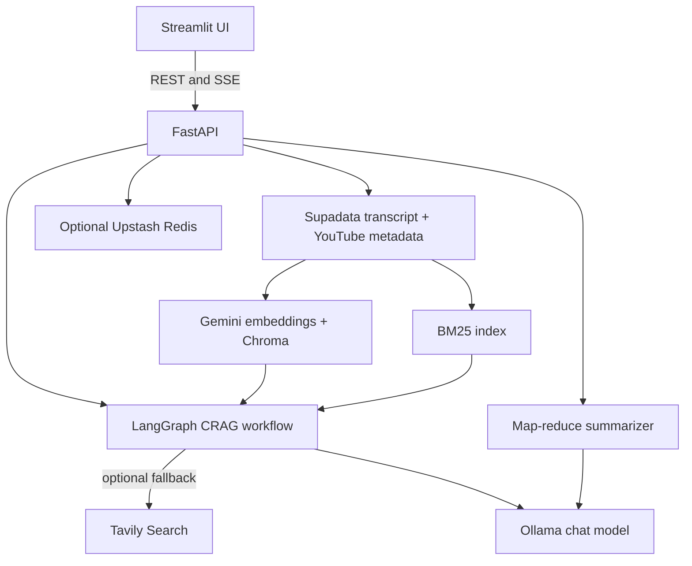

# YouTube RAG Intelligence

YouTube RAG Intelligence turns a YouTube video transcript into a searchable, conversational knowledge base. Paste a video URL to load its transcript, ask questions with timestamped citations, explore transcript segments, and generate a structured summary.

The project has a Streamlit frontend and an asynchronous FastAPI backend. The backend uses LangGraph for corrective retrieval, Gemini embeddings with Chroma and BM25 for hybrid search, Ollama for answer and summary generation, Supadata for transcript extraction, optional Tavily web search, and optional Upstash Redis for conversation storage and graph checkpoints.

## Features

- Ingest video transcripts and metadata from a YouTube video ID.
- Search transcript content with dense vector and BM25 retrieval fused using reciprocal rank fusion.
- Answer questions through a LangGraph corrective RAG workflow, with timestamp citations and an optional Tavily fallback.
- Generate long-form summaries through a map-reduce pipeline, with both streaming and non-streaming API endpoints.
- Browse and search transcript segments in the UI, jump to timestamps, and export transcript text.
- Manage user profiles and chat sessions; persist sessions and graph checkpoints in Upstash Redis when configured.
- Cache active video indexes in process memory with configurable capacity and inactivity expiration.

## Architecture



For chat, the graph rewrites follow-up questions when needed, retrieves transcript passages using dense and lexical search, grades relevance, and attempts corrective retrieval before optionally using web search. It then streams the answer to the UI. Video indexes are ephemeral and held in the backend process; Redis is used for chat history and the LangGraph checkpointer when configured.

## Technology

| Area | Implementation |
|---|---|
| Frontend | Streamlit |
| API | FastAPI, Uvicorn, Server-Sent Events (SSE) |
| RAG orchestration | LangGraph and LangChain |
| Chat and summary models | Ollama-compatible API; defaults to `gemma4:31b-cloud` |
| Embeddings | Google Gemini, `models/gemini-embedding-2` |
| Retrieval | In-memory Chroma, BM25, reciprocal rank fusion (`k=60`) |
| Transcript provider | Supadata |
| Optional web search | Tavily |
| Optional persistence | Upstash Redis REST and LangGraph Redis checkpointer |
| Deployment | Docker; AWS ECR and CodeDeploy scripts/workflow are included |

## Repository Layout

```text
.
├── backend/
│   ├── core/                 # RAG workflow, prompts, ingestion, LLM, summaries
│   ├── routes/               # FastAPI route groups and request schemas
│   ├── services/             # Redis, transcript, search, and YouTube integrations
│   └── utils/                # Shared constants, logging, timestamp, URL helpers
├── frontend/
│   ├── app.py                # Streamlit entry point
│   ├── components/           # Landing, chat, summary, sidebar, transcript UI
│   ├── services/api/         # Backend HTTP and SSE clients
│   └── assets/               # UI styles
├── tests/                    # unittest-compatible tests
├── deploy/scripts/           # EC2 install, start, and stop scripts
├── .github/workflows/        # CI and optional AWS deployment workflow
├── Dockerfile
├── appspec.yml
├── pyproject.toml
├── requirements.txt
└── uv.lock
```

## Requirements

- Python 3.12 or newer.
- API credentials for Ollama and Google Gemini.
- A Supadata API key to fetch transcripts.
- Optional: Upstash Redis credentials for persistent sessions and graph checkpoints.
- Optional: a Tavily API key for web search fallback.
- Docker for container deployment.

## Local Setup

### 1. Clone and create a virtual environment

```bash
git clone https://github.com/Aryanupadhyay23/Youtube-RAG-Intelligence.git
cd Youtube-RAG-Intelligence
python -m venv .venv
```

Activate the environment:

```bash
# Linux / macOS
source .venv/bin/activate

# Windows PowerShell
.venv\Scripts\Activate.ps1
```

### 2. Install dependencies

```bash
python -m pip install --upgrade pip
pip install -r requirements.txt
```

For linting and pytest support, install the development tools:

```bash
pip install ruff pytest
```

### 3. Configure environment

Create a `.env` file in the repository root. Set the primary credentials at minimum:

```env
# Required for chat and summaries (one or more Ollama keys)
OLLAMA_API_KEY_ONE=your_ollama_key
OLLAMA_HOST=https://ollama.com
OLLAMA_MODEL=gemma4:31b-cloud
OLLAMA_SUMMARY_MODEL=gemma4:31b-cloud
OLLAMA_NUM_CTX=131072

# Required for transcript embeddings and transcript extraction
GOOGLE_API_KEY=your_google_api_key
SUPADATA_KEY_ONE=your_supadata_key

# Optional additional Supadata keys. Keys are tried in listed order.
SUPADATA_KEY_TWO=your_second_supadata_key
SUPADATA_KEY_THREE=your_third_supadata_key
SUPADATA_KEY_FOUR=your_fourth_supadata_key

# Optional additional Ollama keys. Keys are tried in listed order.
OLLAMA_API_KEY_SECOND=your_second_ollama_key
OLLAMA_API_KEY_THIRD=your_third_ollama_key

# Optional web search fallback
TAVILY_API_KEY=your_tavily_key

# Optional Upstash Redis persistence
UPSTASH_REDIS_REST_URL=https://your-database.upstash.io
UPSTASH_REDIS_REST_TOKEN=your_upstash_rest_token

# Optional video index cache settings
MAX_ACTIVE_VIDEOS=10
VIDEO_INACTIVITY_TTL_MINUTES=45

# Optional: frontend backend URL (defaults to http://127.0.0.1:8000)
BACKEND_API_URL=http://127.0.0.1:8000
```

The application also accepts `GEMINI_API_KEY` as an alias for `GOOGLE_API_KEY`. Supadata keys can use numbered names (`SUPADATA_KEY_1` through `_4`) or word names as shown above. Ollama keys support `OLLAMA_API_KEY_ONE`, `OLLAMA_API_KEY_SECOND`, `OLLAMA_API_KEY_THIRD` and numeric aliases; `OLLAMA_API_KEY` is also accepted. If Redis is not configured or cannot be initialized, the graph checkpointer falls back to in-memory storage. Chat session persistence also requires Redis to be configured.

Keep `.env` and real credentials private; never commit them to source control.

### 4. Start the application

Run the backend and frontend in separate terminals from the repository root:

```bash
# Terminal 1: FastAPI backend
uvicorn backend.main:app --reload --port 8000
```

```bash
# Terminal 2: Streamlit frontend
streamlit run frontend/app.py --server.port 8501
```

Open <http://localhost:8501>. The API and Swagger docs are available at <http://localhost:8000> and <http://localhost:8000/docs>.

## Tests and Linting

The tests use Python's `unittest` and can also be run with pytest:

```bash
python -m unittest discover tests
# or
pytest
```

Run Ruff if installed:

```bash
ruff check .
```

## Docker

The Docker image uses Python 3.12, installs dependencies in a builder stage, and runs the API and Streamlit processes as a non-root user. The container serves the API on port `8000` and Streamlit on port `7860`.

```bash
docker build -t youtube-rag-intelligence .
docker run --rm --name youtube-rag \
  -p 8000:8000 \
  -p 7860:7860 \
  --env-file .env \
  youtube-rag-intelligence
```

Open the UI at <http://localhost:7860> and the API docs at <http://localhost:8000/docs>. The image health check targets `http://127.0.0.1:8000/health`.

## AWS Deployment

The repository includes an AWS CodeDeploy AppSpec and EC2 lifecycle scripts. `deploy/scripts/install_dependencies.sh` prepares Docker and AWS CLI on the instance; `start_docker.sh` pulls the `latest` image from ECR and starts the container, optionally loading `/home/ubuntu/.env` or `/home/ubuntu/app/.env`; `stop_docker.sh` removes the prior container.

The GitHub Actions workflow at `.github/workflows/deploy.yml` defines Ruff, unit-test, Python compilation, and smoke-test CI plus an optional ECR/S3/CodeDeploy deployment. **The checked-in workflow is gated off by default** (`EXECUTE_PIPELINE: "false"` and `ENABLE_AWS: "false"`), so a push does not currently run CI or deploy. Enable the workflow gates and configure the required AWS credentials/secrets and infrastructure before using it. The deployment script configures Streamlit at `/youtube-rag` and FastAPI's root path at `/youtube-rag-backend` behind the expected reverse proxy.

## Configuration Reference

| Variable | Required | Default | Purpose |
|---|---|---|---|
| `OLLAMA_API_KEY_ONE` or another supported Ollama key | Yes for model calls | — | Ollama API authentication; configured keys form the model fallback chain |
| `OLLAMA_HOST` | No | `https://ollama.com` | Ollama-compatible API host |
| `OLLAMA_MODEL` | No | Value of `OLLAMA_SUMMARY_MODEL` | Chat and RAG model |
| `OLLAMA_SUMMARY_MODEL` | No | `gemma4:31b-cloud` | Summary model |
| `OLLAMA_NUM_CTX` | No | `131072` | Model context window passed to Ollama |
| `GOOGLE_API_KEY` / `GEMINI_API_KEY` | Yes for indexing | — | Gemini embeddings authentication |
| `SUPADATA_KEY_ONE` or `SUPADATA_KEY_1` | Yes for transcript ingestion | — | Primary Supadata key; up to four keys are supported |
| `TAVILY_API_KEY` | No | — | Web search fallback key |
| `UPSTASH_REDIS_REST_URL` | No | — | Upstash REST endpoint |
| `UPSTASH_REDIS_REST_TOKEN` | No | — | Upstash REST authentication token |
| `REDIS_URL` | No | — | Optional Redis connection URL used by Redis services |
| `MAX_ACTIVE_VIDEOS` | No | `10` | Maximum active video indexes in process memory |
| `VIDEO_INACTIVITY_TTL_MINUTES` | No | `45` | Idle cache expiration in minutes |
| `BACKEND_API_URL` | No | `http://127.0.0.1:8000` | Backend URL used by the Streamlit API client |

## Troubleshooting

| Symptom | Likely cause | What to check |
|---|---|---|
| Transcript unavailable | Video is private, blocked, or has no accessible captions | Try a public video with captions and verify the Supadata key |
| Video initialization fails | Missing/invalid transcript or Gemini credentials, or provider/network issue | Check backend logs and `GOOGLE_API_KEY` / `SUPADATA_KEY_ONE` |
| Chat or summary model errors | Missing Ollama credentials, quota, or unreachable model host | Check `OLLAMA_HOST`, model names, and configured Ollama keys |
| Chat history is not persistent | Redis is not configured or reachable | Set both Upstash REST variables and check `/api/memory/health`; graph checkpoints otherwise use memory |
| UI shows backend offline | Backend is not running or frontend points to a wrong URL | Check the backend `/health` route and `BACKEND_API_URL` |

## License

No license file is currently included. Add a license before redistributing the project under specific terms.
